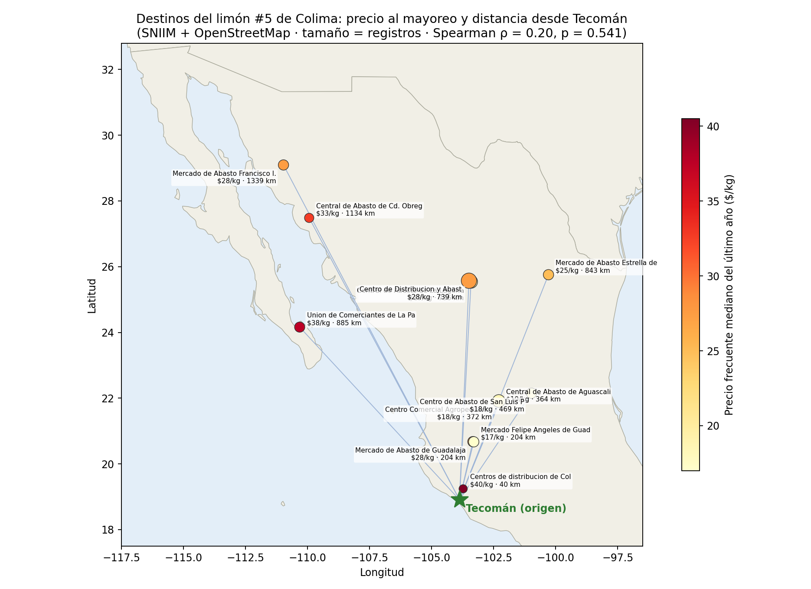

# Ficha de entrega técnica · E2

| Campo | Valor |
|---|---|
| Proyecto | Trusted Data Lab · Observatorio del Precio del Limón de Colima |
| Entrega | E2: Fuente especializada, ética y linaje de datos |
| Tag | `e2` |
| Equipo | Antonio Efraín Arellano Verduzco (23460504) · Oscar Emiliano Ramírez García |
| Repositorio | https://github.com/miumfree03-eng/trusted-data-lab-limon |
| Fecha | 23 de noviembre de 2026 |

## Lista de verificación

| # | Requisito | Dónde está | Estado |
|---|---|---|---|
| 1 | **Fuente especializada geoespacial** (OpenStreetMap + GeoPandas con visualización cartográfica) | `extractores/osm_centrales.py` (Bronce) · `src/geo_centrales.py` (Plata y Oro) · [mapa](mapa_centrales.png) | ✅ |
| 2 | **Declaración de ética y legalidad** (términos, robots.txt, licencias, sesgos y privacidad) | [`docs/etica-datos.md`](../etica-datos.md) | ✅ |
| 3 | **Linaje y trazabilidad:** cada registro de Oro rastreable hasta Bronce y su fecha de ingesta | `id_registro`, `archivo_bronce` y `capturado_utc` en Plata · `n_registros_origen`, `archivos_bronce` e `ingesta_min/max_utc` en Oro · `data/oro/linaje_oro.csv` · prueba `tests/test_linaje.py` | ✅ |
| 4 | Ficha de entrega y relatoría | este archivo · [`docs/relatoria-E2.md`](../relatoria-E2.md) | ✅ |

## Fuente geoespacial

- **Bronce:** `data/bronce/osm_centrales/*.json`, con la respuesta cruda de Nominatim por central, la consulta usada, la precisión, la licencia y la hora de captura.
- **Plata:** `data/plata/centrales_geo.geojson` (EPSG:4326), con las 15 centrales.
- **Oro:** `data/oro/centrales_precio_distancia.geojson`, que une cada central con su precio frecuente mediano del último año y su distancia geodésica (WGS84) desde Tecomán, Colima.



**Hallazgo:** con 12 centrales que tienen precio el último año, **no encontramos relación significativa entre la distancia y el precio** (Spearman ρ = 0.20, p = 0.54). El precio en destino depende más del mercado local que del flete, y el destino más caro fue el propio Colima ($40.50/kg). Este hallazgo alimenta el factor "región de destino" del experimento de Estadística.

## Linaje

```
Bronce  data/bronce/sniim_limon/AAAA-MM.csv  (capturado_utc por fila)
   │   id_registro = sha1(archivo_bronce | fecha | destino | presentación)[:16]
Plata  data/plata/sniim_limon_plata.csv     (id_registro, archivo_bronce, capturado_utc)
   │   data/oro/linaje_oro.csv  ->  (semana, central) → id_registro
Oro    data/oro/limon_semanal_central.csv   (n_registros_origen, archivos_bronce, ingesta_min_utc, ingesta_max_utc)
       data/oro/limon_semanal_nacional.csv  (ídem, por semana)
```

La prueba `tests/test_linaje.py` verifica en cada corrida de la Action que:
- Toda fila observada de Oro tiene origen y fecha de ingesta (2,536 filas).
- Todo `id_registro` existe en Plata y es único.
- Todo archivo citado existe en Bronce.
- Las filas imputadas (14) se declaran con `n_registros_origen = 0`.

## Cómo verificar

```bash
pip install -r requirements.txt
python extractores/osm_centrales.py     # solo consulta las centrales nuevas
python src/pipeline.py
python tests/test_linaje.py
python src/geo_centrales.py
```
